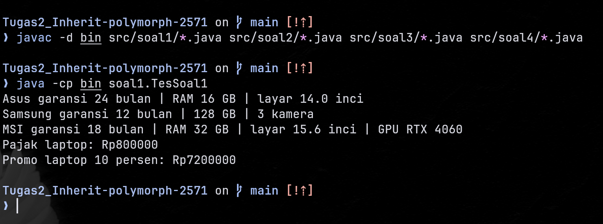
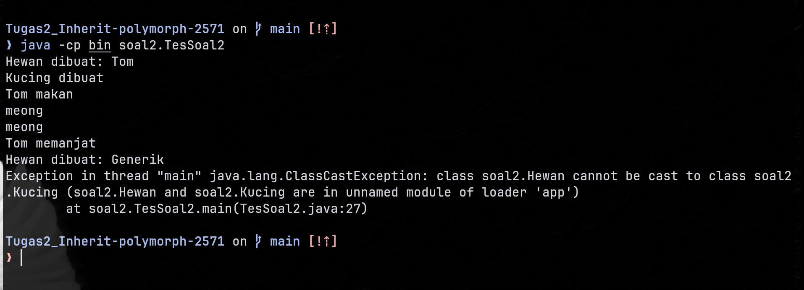
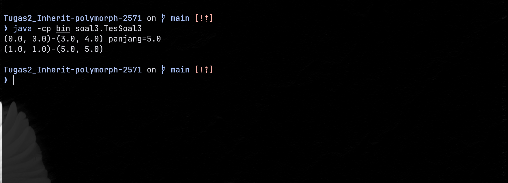
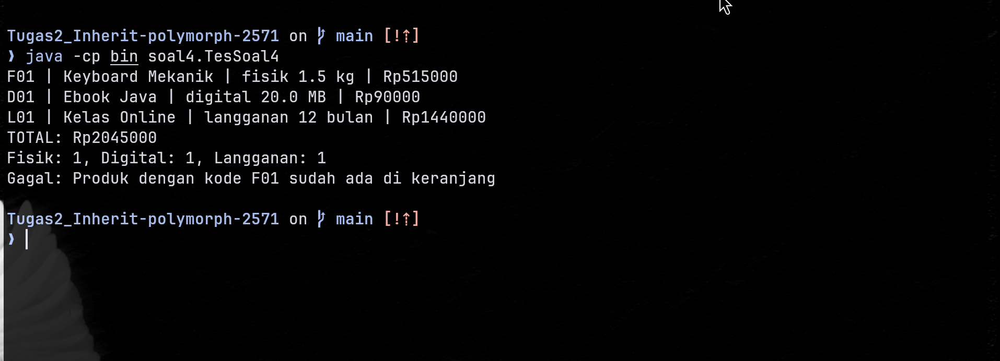

# Tugas 2 Praktikum Pemrograman Berorientasi Objek

* **Nama Lengkap:** Arienal Zacky Irfan
* **NPM:** 2571
* **Kelas:** PBO A
* **Tautan Repository:** [Tugas2_Inherit-polymorph-2571](https://github.com/jaxonphile/Tugas2_Inherit-polymorph-2571)

---

## Deskripsi Singkat
Repository ini berisi implementasi solusi untuk Tugas 2 Praktikum Pemrograman Berorientasi Objek. Praktikum ini berfokus pada penguasaan konsep dasar hingga tingkat lanjut mengenai *Inheritance*, *Composition*, *Polymorphism*, urutan pemanggilan *Constructor*, penanganan *Aliasing* dengan *Defensive Copy*, serta kepatuhan pada standar kualitas kode berstandar industri.

---

## Fitur Utama

### Soal 1: Hierarki Perangkat Elektronik
* Menghitung tarif pajak perangkat elektronik sebesar 10% secara terpusat.
* Mengkalkulasi harga diskon khusus produk Laptop dengan memanfaatkan hak akses `protected`.
* Pemanggilan konstruktor berantai (*constructor chaining*) menggunakan `super(...)` pada subclass (`Laptop`, `Ponsel`, `LaptopGaming`).
* Perluasan informasi objek secara polimorfik tanpa duplikasi kode melalui `super.infoSingkat()`.

### Soal 2: Analisis Output, Error, dan Polimorfisme
* Simulasi dynamic method binding dan pemanggilan polymorphic method.
* Pengujian urutan eksekusi *constructor* pada hierarki pewarisan multi-tingkat.
* Pencegahan *runtime error* (`ClassCastException`) saat *downcasting* menggunakan operator `instanceof`.
* Penerapan *method overriding* pada hierarki `Lingkaran` dan `Titik`.

### Soal 3: Komposisi Titik dan Garis
* Menerapkan hubungan *Composition* (*has-a*) di mana kelas `Garis` tersusun dari dua objek `Titik`.
* Konstruktor *overloading* yang efisien menggunakan keyword `this(...)`.
* Pemanfaatan *delegasi method* (`getPanjang()` mendelegasikan penghitungan ke `Titik.jarakKe()`).
* Implementasi *Defensive Copy* pada konstruktor dan *getter/setter* untuk menjamin imutabilitas data internal dari ancaman *aliasing*.

### Soal 4: Mini Project Toko Digital
* Menghitung harga akhir tiga jenis produk dengan aturan berbeda: produk fisik (ditambah ongkos kirim per kg), produk digital (diskon 10%), dan langganan (harga dikali durasi, diskon 20% jika minimal 12 bulan).
* Menambahkan produk ke keranjang belanja dan menolak produk dengan kode yang sudah ada.
* Mencetak struk berisi kode, nama, keterangan jenis, harga akhir, dan total belanja.
* Menampilkan jumlah produk per jenis (fisik, digital, langganan) tanpa salah hitung.
* Menolak data tidak valid (harga negatif atau nama kosong) dengan pesan error yang jelas.

---

## Konsep OOP yang Diterapkan

| Konsep OOP | Lokasi Penerapan | Alasan Pemilihan |
| :--- | :--- | :--- |
| **Inheritance (Is-A)** | `Laptop extends Perangkat`, `Kucing extends Hewan`, `Langganan extends ProdukDigital` | Memungkinkan subclass mewarisi atribut/method umum dari superclass untuk meminimalkan duplikasi kode. |
| **Encapsulation & Access Modifiers** | `protected double harga` pada `Perangkat`, `private Titik awal` pada `Garis`, `private final` pada atribut `Produk` | Mengamankan atribut dari akses luar secara langsung sekaligus mengizinkan akses internal pada subclass. |
| **Composition (Has-A)** | Class `Garis` menyimpan `private Titik awal, akhir`, class `Keranjang` menyimpan `ArrayList<Produk>` | Merepresentasikan hubungan kepemilikan struktur nyata (Garis memiliki Titik, Keranjang memiliki Produk). |
| **Polymorphism (Overriding)** | Method `infoSingkat()` di `LaptopGaming`, `luas()` di `Titik`, `hitungHargaAkhir()` dan `deskripsi()` di seluruh subclass `Produk` | Memungkinkan pemanggilan method yang sama untuk menghasilkan perilaku spesifik berdasarkan tipe dinamis objek. |
| **Downcasting Aman (`instanceof`)** | `Keranjang.hitungPerJenis()` | Membedakan jenis produk saat informasi tersebut tidak tersedia lewat method superclass, dengan urutan pengecekan yang benar. |
| **Constructor Chaining** | Keyword `super(...)` pada `LaptopGaming` dan `Langganan`, `this(...)` pada `Garis` | Menjamin inisialisasi status objek induk atau konstruktor utama berjalan secara konsisten. |
| **Defensive Copy** | Constructor & Getter pada kelas `Garis` | Mencegah *side-effect* akibat mutasi objek referensi luar (*aliasing*). |
| **Konstanta (tanpa Magic Number)** | `ONGKOS_KIRIM_PER_KG`, `DISKON_DIGITAL`, `DISKON_LANGGANAN`, `BATAS_BULAN_DISKON` | Memberi nama pada nilai tarif sehingga maksudnya jelas dan mudah diubah dari satu tempat. |

---

## Struktur Project

```
├── 📁 .github
│   └── 📁 workflows
│       └── ⚙️ ci.yml
├── 📁 screenshots
│   ├── 🖼️ OutputSoal1.png
│   ├── 🖼️ OutputSoal2.png
│   ├── 🖼️ OutputSoal3.png
│   └── 🖼️ OutputSoal4.png
├── 📁 src
│   ├── 📁 soal1
│   │   ├── ☕ Laptop.java
│   │   ├── ☕ LaptopGaming.java
│   │   ├── ☕ Perangkat.java
│   │   ├── ☕ Ponsel.java
│   │   └── ☕ TesSoal1.java
│   ├── 📁 soal2
│   │   ├── ☕ A.java
│   │   ├── ☕ B.java
│   │   ├── ☕ Hewan.java
│   │   ├── ☕ Kucing.java
│   │   ├── ☕ Lingkaran.java
│   │   ├── ☕ TesSoal2.java
│   │   └── ☕ Titik.java
│   ├── 📁 soal3
│   │   ├── ☕ Garis.java
│   │   ├── ☕ TesSoal3.java
│   │   └── ☕ Titik.java
│   └── 📁 soal4
│       ├── ☕ Keranjang.java
│       ├── ☕ Langganan.java
│       ├── ☕ Produk.java
│       ├── ☕ ProdukDigital.java
│       ├── ☕ ProdukFisik.java
│       └── ☕ TesSoal4.java
├── ⚙️ .gitignore
└── 📝 README.md
```

---

## Prasyarat & Cara Menjalankan Program

### Prasyarat
* **Java Development Kit (JDK):** Versi 17 atau lebih baru.
* **IDE (Disarankan):** IntelliJ IDEA (VS Code atau Eclipse juga bisa).

### Menjalankan via IntelliJ IDEA

1. Buka IntelliJ IDEA, pilih **File > Open**, lalu pilih folder root repositori.
2. Buka **File > Project Structure > Modules**, tandai folder `src` sebagai **Sources**, lalu atur **Project SDK** ke JDK 17 atau lebih baru.
3. Buka salah satu kelas uji (misalnya `src/soal4/TesSoal4.java`), lalu klik ikon panah hijau di samping `main` dan pilih **Run 'TesSoal4.main()'**.
4. Untuk pengaturan manual, buka **Run > Edit Configurations > Add New > Application**, lalu isi:
   * **Module / classpath:** modul project
   * **Main class:** `soal1.TesSoal1`, `soal2.TesSoal2`, `soal3.TesSoal3`, atau `soal4.TesSoal4`
5. Klik **Run** untuk melihat output di jendela konsol.

### Menjalankan via Terminal / Command Line

1. Buka terminal pada root folder repositori.
2. Kompilasi seluruh berkas Java ke folder `bin`:
   ```bash
   javac -d bin src/soal1/*.java src/soal2/*.java src/soal3/*.java src/soal4/*.java
   ```
3. Jalankan masing-masing kelas pengujian:
   * **Eksekusi Soal 1:**
     ```bash
     java -cp bin soal1.TesSoal1
     ```
   * **Eksekusi Soal 2:**
     ```bash
     java -cp bin soal2.TesSoal2
     ```
   * **Eksekusi Soal 3:**
     ```bash
     java -cp bin soal3.TesSoal3
     ```
   * **Eksekusi Soal 4:**
     ```bash
     java -cp bin soal4.TesSoal4
     ```

> Folder `bin` dibuat otomatis oleh perintah `javac` dan diabaikan oleh `.gitignore`, sehingga tidak ikut tersimpan di repository.

---

## Contoh Output

### Soal 1


```text
Asus | garansi 24 bulan | RAM 16 GB | layar 14.0 inci
Samsung | garansi 12 bulan | 128 GB | 3 kamera
MSI | garansi 18 bulan | RAM 32 GB | layar 15.6 inci | GPU RTX 4060
Pajak laptop: Rp800000
Promo laptop 10 persen: Rp7200000
```

### Soal 2


Skenario ketika exception terjadi (`ClassCastException` pada downcasting) dan skenario setelah diperbaiki dengan `instanceof` dapat dilihat pada bagian jawaban Soal 2 di bawah.

### Soal 3


```text
(0.0, 0.0) - (3.0, 4.0) panjang=5.0
(1.0, 1.0) - (5.0, 5.0)
```

### Soal 4
**Skenario normal dan skenario exception tertangani:**



```text
F01 | Keyboard Mekanik | fisik 1.5 kg | Rp515000
D01 | Ebook Java | digital 20.0 MB | Rp90000
L01 | Kelas Online | langganan 12 bulan | Rp1440000
TOTAL: Rp2045000
Fisik: 1, Digital: 1, Langganan: 1
Gagal: Produk dengan kode F01 sudah ada di keranjang
```

Baris terakhir muncul karena produk dengan kode `F01` ditambahkan dua kali, sehingga `IllegalStateException` dilempar dan ditangani oleh blok `catch` di `TesSoal4`.

---

## Jawaban Soal dan Analisis Konsep

### Pertanyaan Tambahan Soal 1
> **Pertanyaan:** Ubah harga menjadi `private` lalu kompilasi. Salin pesan error yang muncul dan jelaskan mengapa error tersebut muncul.

* **Pesan Error Kompilasi:**
  ```text
  src/soal1/Laptop.java: error: harga has private access in Perangkat
          return this.harga * (1.0 - (diskonPersen / 100.0));
                     ^
  1 error
  ```
* **Penjelasan:** Error terjadi karena atribut dengan hak akses `private` hanya dapat diakses secara langsung dari dalam badan kelas tempat atribut tersebut dideklarasikan (yaitu kelas `Perangkat`). Meskipun `Laptop` adalah subclass dari `Perangkat`, `Laptop` tidak memiliki akses langsung ke atribut `private` milik induknya. Agar subclass dapat mengakses atribut secara langsung tanpa getter, atribut tersebut harus diberi hak akses `protected`.

---

### Jawaban Soal 2

#### Bagian A
1. **Output Lengkap Program (sebelum perbaikan error):**
   ```text
   Hewan dibuat: Tom
   Kucing dibuat
   Tom makan
   meong
   meong
   Tom memanjat
   Hewan dibuat: Generik
   Exception in thread "main" java.lang.ClassCastException: class soal2.Hewan cannot be cast to class soal2.Kucing
   	at soal2.TesSoal2.main(TesSoal2.java)
   ```

2. **Analisis jika komentar `h.panjat();` dihapus:**
   * **Tahap Error:** Kompilasi (*Compile-time Error*).
   * **Pesan Error:** `cannot find symbol / symbol: method panjat()`.
   * **Alasan:** Variabel `h` memiliki tipe statis `Hewan`. Pada tahap kompilasi, Java hanya memeriksa method yang terdaftar pada tipe statis variabel. Karena kelas `Hewan` tidak memiliki method `panjat()`, maka kompilator menolak kode tersebut meskipun tipe dinamisnya saat runtime adalah `Kucing`.

3. **Baris Penyebab ClassCastException & Perbaikannya:**
   * **Baris Penyebab:** `Kucing k2 = (Kucing) h2;`
   * **Perbaikan dengan `instanceof`:**
     ```java
     Hewan h2 = new Hewan("Generik");
     if (h2 instanceof Kucing) {
         Kucing k2 = (Kucing) h2;
         k2.panjat();
     } else {
         System.out.println("Downcasting gagal: h2 bukan instance dari Kucing");
     }
     ```

4. **Analisis Pemanggilan `suara()` pada `h.makan()`:**
   * Method `suara()` yang dieksekusi adalah milik kelas **`Kucing`**.
   * **Penjelasan (Tipe Statis vs Tipe Dinamis):** Tipe statis variabel `h` adalah `Hewan`, sedangkan tipe dinamis objek yang dirujuk di memori heap adalah `Kucing`. Di Java, pemanggilan method instance menggunakan *dynamic binding* (polimorfisme runtime). Saat `makan()` dipanggil dari `Hewan`, pemanggilan internal `suara()` dievaluasi berdasarkan tipe dinamis objek (`Kucing`), sehingga method `suara()` milik `Kucing` lah yang dieksekusi.

#### Bagian B
5. **Prediksi vs Hasil Eksekusi `new B();`:**
   * **Output Sebenarnya:**
     ```text
     A dibuat
     init B, nilai=0
     B dibuat, nilai=5
     ```
   * **Alasan `nilai` pada `init B` bernilai 0:**
     Saat `new B()` dieksekusi, konstruktor `A()` berjalan terlebih dahulu (`super()`). Dari dalam konstruktor `A()`, method `init()` dipanggil. Karena `init()` telah di-override di kelas `B`, maka `init()` milik `B` dieksekusi. Namun pada fase ini, inisialisasi atribut kelas `B` (`int nilai = 5`) **belum berjalan**, sehingga variabel `nilai` masih berisi nilai default tipe data primitif `int`, yaitu `0`.
   * **Risiko Pemanggilan Method Overridable dari Konstruktor:**
     Sangat berbahaya karena method hasil override dapat mengakses atribut subclass yang **belum selesai diinisialisasi**, sehingga berpotensi menyebabkan bug logika atau `NullPointerException`.

#### Bagian C
6. **Analisis `l3.luas()` dan Evaluasi Relasi Is-A:**
   * **Mengapa `l3.luas()` bernilai 0.0:** Pemanggilan `l3.luas()` mengeksekusi method `luas()` milik kelas `Titik` karena tipe dinamis objek `l3` adalah `Titik` (polimorfisme).
   * **Kevalidan Relasi Is-A:** "Titik adalah sebuah Lingkaran" **tidak masuk akal** secara konsep domain geometri. Lingkaran mendefinisikan bidang 2D dengan luas dan keliling berbasis jari-jari, sedangkan Titik hanya menyatakan posisi koordinat tanpa dimensi.
   * **Konsekuensi Desain:** Jika suatu method mengharapkan objek `Lingkaran` dan berasumsi luasnya selalu $> 0$, melewatkan objek `Titik` akan merusak asumsi *pre-condition* program dan melanggar *Liskov Substitution Principle (LSP)*.

---

### Jawaban Soal 3

1. **Prediksi & Hasil Eksekusi Baris Kedua (sebelum Defensive Copy):**
   * **Hasil:** `(100.0, 1.0) - (5.0, 5.0)`
   * **Penyebab:** Konstruktor `Garis` menyimpan referensi objek `Titik` secara langsung. Akibatnya, variabel `t` di `main` dan atribut `awal` pada objek `g2` menunjuk ke alokasi memori yang sama (*aliasing*). Saat `t.setX(100)` dipanggil, data di dalam `g2` ikut berubah.

2. **Hasil Eksekusi Setelah Perbaikan (dengan Defensive Copy):**
   * **Hasil:** `(1.0, 1.0) - (5.0, 5.0)`
   * **Penjelasan:** Konstruktor dan getter/setter `Garis` telah diperbaiki untuk membuat instansiasi objek `Titik` baru (`new Titik(...)`). Perubahan pada variabel `t` di luar tidak lagi memengaruhi status internal `g2`.

3. **Kapan Menggunakan / Tanpa Defensive Copy:**
   * **Dengan Defensive Copy:** Tepat digunakan saat kita membutuhkan **enkapsulasi ketat** dan **imutabilitas**, sehingga objek internal terjamin aman dari efek samping (*side-effect*) perubahan kode luar.
   * **Tanpa Defensive Copy (Shared Reference):** Tepat digunakan pada sistem yang membutuhkan **pembaruan data terpusat (real-time update)**, di mana beberapa komponen harus merefleksikan perubahan status dari objek acuan yang sama secara otomatis.

4. **Masalah Desain Jika `Garis extends Titik`:**
   * **Pelanggaran Relasi:** Terjadi kesalahan konsep relasi. Garis **bukanlah** sebuah Titik (*is-a*), melainkan Garis **memiliki** Titik (*has-a*).
   * **Pencemaran Interface (Interface Pollution):** Kelas `Garis` akan mewarisi method `setX()` dan `setY()` yang tidak relevan (karena Garis memiliki dua titik, bukan satu). Hal ini membingungkan pengguna kelas dan merusak enkapsulasi.

---

### Analisis Konsep

1. **Perbedaan method overriding dan method overloading**

   *Overriding* terjadi ketika subclass menulis ulang method milik superclass dengan nama dan parameter yang sama, sedangkan *overloading* terjadi ketika satu kelas punya beberapa method atau constructor dengan nama sama tetapi parameter berbeda. Contoh overriding di tugas ini adalah `hitungHargaAkhir()` pada `ProdukFisik` yang menggantikan versi milik `Produk`. Contoh overloading adalah dua constructor `Garis`, yaitu `Garis(Titik, Titik)` dan `Garis(double, double, double, double)`. Overriding bergantung pada inheritance dan menjadi dasar polimorfisme, karena method yang dijalankan dipilih saat program berjalan berdasarkan tipe dinamis objek. Overloading tidak membutuhkan inheritance, karena Java memilih versinya saat kompilasi berdasarkan daftar parameter.

2. **Kapan memilih inheritance dan kapan memilih composition**

   Inheritance dipilih ketika hubungan antar kelas benar-benar *is-a* dan subclass dapat menggantikan superclass tanpa merusak perilaku program. Contohnya `Langganan extends ProdukDigital`, karena langganan memang sebuah produk digital yang punya aturan harga sendiri. Composition dipilih ketika satu kelas *memiliki* objek kelas lain sebagai bagian dari dirinya. Contohnya `Keranjang` yang menyimpan `ArrayList<Produk>`, karena keranjang bukan sebuah produk, melainkan wadah bagi produk. Pola yang sama berlaku pada `Garis` yang tersusun dari dua `Titik`, dan composition umumnya lebih fleksibel karena tidak mengikat kelas pada hierarki tertentu.

3. **Mengapa `cetakStruk()` tidak memerlukan `instanceof` sedangkan `hitungPerJenis()` memerlukannya**

   `cetakStruk()` hanya memanggil `hitungHargaAkhir()` dan `deskripsi()`, dan kedua method itu sudah ada di `Produk` serta di-override oleh tiap subclass. Karena itu Java otomatis menjalankan versi yang tepat lewat polimorfisme, tanpa perlu mengetahui jenis produk. Sebaliknya, `hitungPerJenis()` harus mengetahui jenis sebenarnya dari tiap objek, dan informasi itu tidak tersedia lewat method superclass, sehingga `instanceof` diperlukan. Pengecekan `Langganan` harus didahulukan sebelum `ProdukDigital`, karena `Langganan` juga merupakan `ProdukDigital` dan hasil hitungan akan salah jika urutannya terbalik. Downcasting tidak selalu aman karena kompilator hanya memeriksa tipe statis, sehingga cast ke tipe yang salah baru gagal saat program berjalan dengan `ClassCastException`, seperti pada kasus `Hewan` yang di-cast ke `Kucing` di Soal 2.

---

## Batasan dan Pengembangan Lanjutan
* Pengujian saat ini berfokus pada skenario pada kelas uji `TesSoal1`, `TesSoal2`, `TesSoal3`, dan `TesSoal4`, belum memakai framework pengujian otomatis seperti JUnit.
* Tantangan opsional pada Soal 4 (`ProdukBundel` dengan diskon bundel) belum dikerjakan.
* Keranjang belum mendukung penghapusan produk atau perubahan jumlah barang, dan hanya menangani satu mata uang (Rupiah).
* Pengembangan lanjutan yang mungkin: menambahkan pengujian JUnit, menyimpan data keranjang ke berkas, dan menambahkan antarmuka pengguna.